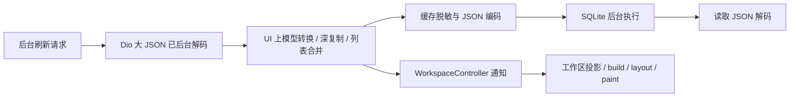

# Android 性能接口与 Raft Flutter 全树审计

日期：2026-10-11。任务：task #11；讨论：#raft-flutter:6f8ec26c。

最值得先做的是减少后台响应给 UI 线程带来的工作，然后缩小更新范围、真正按可见行创建长列表。Android 的通用性能提示接口确实存在，但不能消除同步编解码、整页重建或多次布局造成的阻塞。本轮已完成缓存大数据编解码修复；其余方向按证据和验证成本排序。

## 审计范围与结论等级

基线 `4e87659cda0bc0ec63bdb56e56e16805c93cf54a`，Flutter 3.47.6、Dart 3.13.5，framework `5fc346839b5d0eef006ed8404392afb4dfae428d`，engine `692136cb6582dbfc5af3fb33c2515a069f2f66d0`。Android compile/target SDK 37；最低 SDK 至少 24。审计期间主检出保持不变，修复在隔离分支进行。

已冻结 871 个文件，并对 App 与全部本地 packages 的 599 个 Dart library 文件做全树模式筛查：App 214、flutter_chat_ui 20、raft_client 7、raft_sync 7、raft_ui 351。启发式分类为运行相关 390、preview 80、生成文件 129；分类不等于实际 import 可达性证明。完整路径、SHA、行号和命中内容见 `source-manifest.json`、`pattern-scan.json`。随后手工追踪数据落地与 UI 通知链，并复核下面各类热点。模式命中数量不作为缺陷数量。

报告区分：**已复现并修复**、**代码中确定存在的额外工作**、**需真机确认的性能候选**。没有把全树静态筛查表述为所有页面都已真机测量，也没有声称整版达到 120fps。

## 1. Android 16/17 能不能主动申请更高性能

可以向系统提供性能需求，不能保证最高频率。ADPF 也适用于性能密集的普通 App，无需把聊天 App 标成游戏。[Android 官方 ADPF 说明](https://developer.android.com/games/optimize/adpf)

| 接口 | 版本 | 对本项目的意义 |
|---|---|---|
| `PerformanceHintManager.createHintSession`、报告实际耗时/目标耗时 | Java API 31，Android 12 | 针对一组真实进程线程的周期性工作提供调度提示；设备可能不支持、创建可能返回 null。[Java 参考](https://developer.android.com/reference/android/os/PerformanceHintManager) |
| `APerformanceHint_*` 基础 session | NDK API 33，Android 13 | 原生 Flutter 引擎层可接入；按真实工作时间反馈。[NDK 参考](https://developer.android.com/ndk/reference/group/a-performance-hint) |
| CPU/GPU 分项 `AWorkDuration`、`reportActualWorkDuration2` | API 35，Android 15 | 为图形周期提供更完整反馈。`setPreferPowerEfficiency` 同版本，但用途是偏向节能。[Session 参考](https://developer.android.com/reference/android/os/PerformanceHintManager.Session) |
| `notifyWorkloadIncrease` / `Reset` / `Spike` | **NDK API 36，Android 16** | 增载、重置或下一周期短时重活的提前提示，最接近“列表加载/转场前先申请性能”。效果面向一个周期且系统限流，不应逐帧重复请求。[NDK 参考](https://developer.android.com/ndk/reference/group/a-performance-hint) |
| graphics pipeline、surface binding、CPU/GPU auto timing、feature probing | **NDK API 36** | 有条件地将提示与真实图形管线关联；自动计时有自己的报告规则，需先检查每项设备能力。[NDK 参考](https://developer.android.com/ndk/reference/group/a-performance-hint) |
| CPU/GPU headroom | API 36 | 估计资源余量，帮助降负载/诊断；不是提速按钮。[Android 16 说明](https://developer.android.com/about/versions/16/features#headroom-apis) |
| ProfilingManager 新触发原因 | Android 17 | 冷启动、OOM、CPU 超额等异常时采样，属于诊断。[Android 17 说明](https://developer.android.com/about/versions/17/features) |

版本核验同时使用安装的官方 NDK 30.0.15729638 `android/performance_hint.h` 的 `__INTRODUCED_IN` 标注；上述新 NDK 能力标注 36，不能说成 Android 17 才新增。17 可使用已有接口，是否有效仍由设备能力决定。

另有刷新率接口：ARR 的 View 帧率偏好、Window touch boost 属于 Android 15 系列；支持 ARR 的设备要求相应 HAL 和 Android 15 QPR1 以上。默认触摸、窗口转场可能已有提速。Flutter 自绘 Surface 中的列表不会自动成为原生 RecyclerView，不能照搬其 fling 策略。[ARR 官方说明](https://developer.android.com/develop/ui/views/animations/adaptive-refresh-rate)

`Surface.setFrameRate` 是刷新率偏好；系统仍参与决策，频繁切换还可能引起掉帧。它不会让 40ms 的 UI 工作自动缩短到 8.33ms。[Frame rate 官方说明](https://developer.android.com/media/optimize/performance/frame-rate)

`Window.setSustainedPerformanceMode`（API 24）面向长时间的稳定性能，可能通过限制峰值避免热降频；不适合作为每次转场的短时加速方案。[AOSP performance management](https://source.android.com/docs/core/power/performance) 不建议使用 Game Mode 或厂商私有提速服务；固定频率模式是基准工具，也不应当作为产品功能。

### 当前 Flutter 是否已接入

App 没有显式 ADPF 调用。对固定引擎提交的官方完整源码归档中 4,624 个 engine 源文件检索 `APerformanceHint`、`PerformanceHintManager`、`performance_hint.h`、`notifyWorkload`、`adpf`，均为零命中。完整 SHA 清单与检索结果在 `official-sources/pinned-engine-adpf-scan.json`。因此不能把 ADPF 当作当前 SDK 已提供的能力；系统自身默认调度/触摸提速仍可能有效。

截至本次检查，Flutter 的 [ADPF PR #192582](https://github.com/flutter/flutter/pull/192582) 仍为 **draft/open，未合并**，不能作为已发布特性或直接用于正式版。

当前 `MobileWorkspacePages` 使用 `MaterialPage`，Flutter 的 `TransitionRoute` 已在动画期间申请 `DartPerformanceMode.latency`，结束后释放。它影响 Dart 运行时的延迟策略，并非 Android 电源提示；正常 Navigator 转场无需重复加一层相同请求。[固定版本 routes.dart](https://github.com/flutter/flutter/blob/5fc346839b5d0eef006ed8404392afb4dfae428d/packages/flutter/lib/src/widgets/routes.dart#L299)、[Scheduler API](https://api.flutter.dev/flutter/scheduler/SchedulerBinding/requestPerformanceMode.html)

### 接入建议

ADPF 放在后续有开关的引擎实验中。先解决下文已确认的 UI 工作，再判断剩余首帧尖峰是否主要受调度限制。真正接入需要：确定 Flutter UI/platform 合并状态和 raster 的实际线程 ID，跟踪线程/Surface 生命周期，按实际刷新率及图形关键路径更新目标和耗时；在能力存在时为明显增载发一次提前提示。App 隐藏、Surface 重建或 session 不支持时正常回退。

只在 Kotlin 中给 Android main thread 建 session、固定上报 8.33ms 或在 HTTP 开始时常开 boost，都不足以覆盖真实 Flutter 图形工作。网络等待不属于 CPU 帧工作；后台刷新也不应持续与前台动画争抢高性能资源。最低 SDK 24 的 App 还需原生 API/符号保护，避免旧系统加载新符号失败。暂不把未完成的引擎实验加入当前修复。

## 2. 后台请求为什么能干扰前台

“异步请求”只让网络等待不阻塞；返回后的同步处理仍能占用 UI isolate。当前链路如下。



### 已复现并修复：缓存编解码

基线 `apps/raft_flutter/lib/platform/workspace_cache.dart:43` 使用 `NativeDatabase.createInBackground`，**SQLite 本来就在后台**；但 `write` 的脱敏与编码（187）、`read` 的解码（165）、翻译批量编码/解码（91–145）在数据库调用前后同步执行。把数据库放后台并未把这些 Dart CPU 工作一起移走。

修复新增 `lib/data/workspace_cache_codec.dart`：只做最多 128 个节点、32Ki 字符的有界检查；大值在独立 isolate 脱敏/编码、读取解码，翻译批次只开一个 worker。小设置不启动 worker。signed-query 正则预编译。缓存公开操作保持 FIFO，包括写入、读取、撤销频道/服务器、清账号和关闭；失败不阻塞后续操作，关闭排空已接受任务。这样 worker await 不会让权限删除先执行、旧写入随后恢复私有内容。

保留原 schema、账号/服务器隔离、脱敏规则、window/translation LRU、缓存即时呈现和权限撤销条件，没有靠清缓存改善性能。

### 可复现的 CPU 对比

`tool/performance/cache_codec_benchmark.dart` 导入真实修复 codec；基线 sanitizer 从 4e87659 原函数复制。仅合成数据，600 行、3,391,126 字符；相同输入，先核对编码输出完全相同。Mac arm64、Dart 3.13.5 **AOT 可执行文件**；1ms 定时器记录工作期间的最大事件循环间隔；各模式 3 次预热后 20 次采样。固定顺序 baseline→worker，非随机交叉实验。

| 最终留有每次原始采样的运行 | 基线 UI 同步 | 大值 worker |
|---|---:|---:|
| 每轮最大事件循环间隔，中位数 | 56.384ms | 2.299ms |
| 同上 P95 | 58.401ms | 2.335ms |
| 编码+解码总时间，中位数 | 55.204ms | 55.394ms |

先前独立一轮相应间隔为 53.544→2.265ms，总时间 52.399→53.121ms，两次方向一致。收益是把重活移开，**不是减少所有 CPU 时间**。600 行属于压力夹具，不代表用户日常每次响应的大小；事件循环计时器不是屏幕帧率，以上不能换算成手机掉帧收益。

验证：86 个相关测试通过，包含 Unicode、源数据不变、凭据/签名地址脱敏、批量翻译顺序、写入与三种撤权交错、失败恢复、关闭排空以及已有持久化、离线、第一帧、LRU、权限生命周期测试；分析零问题，设计系统 `--check` 通过。

复现命令（固定 SDK）：

```sh
/Users/kevinzhow/fvm/versions/3.47.6/bin/dart compile exe tool/performance/cache_codec_benchmark.dart -o /tmp/raft-cache-codec-benchmark
/tmp/raft-cache-codec-benchmark
```

需要关注的代价：大值 worker 有启动/输入传递开销，阈值是有界工程选择而非已调优最优值；缓存 FIFO 保证撤权顺序，也可能让一个大读取等待前面的缓存任务。现有首帧/离线回归已通过，实际手机启动和后台刷新叠加动画仍需 profile A/B。

### 两个容易误判的地方

`raft_client` 默认使用 Dio 5.11.0 的 `FusedTransformer(contentLengthIsolateThreshold: 50 * 1024)`，大 JSON 响应已用后台解码。不要把它改成“所有网络解码首次搬后台”的修复，或每条小响应都开 isolate。

`background_notifications.dart:123` 中，已有 UI session owner 时，headless worker 会把 poll 交给运行中的 UI 客户端；main.dart:116 绑定 `content.pollBackground`。这是防止凭据轮换竞争的设计，不能为了性能去启动第二个带相同凭据的客户端。应继续保留单一身份 owner，把结果处理和通知范围优化掉。

## 3. 优先级与具体代码证据

除缓存修复外，表内“确定”表示代码确实做了额外工作，尚未测得它在这台手机上的耗时比例。

| 优先级 | 证据/方向 | 具体调整与验收 |
|---|---|---|
| P0 已修 | 上述缓存 CPU 阻塞 | 大值 worker + FIFO；已有回归和 AOT 复现。手机 profile 收益待测。 |
| P1 确定 | `workspace_controller.dart:2984–3015` 接受频道列表，即使行对象已复用，仍保存整列表并 `notifyListeners`；`workspace_view.dart:816` 顶层 merge 监听工作区 | 首先让**真正无变化**的刷新不保存、不通知，再拆 sidebar/content/reaction 的修订信号。必须保留列表顺序、readmit、撤权、generation 和乱序事件处理；不能仅按条数相同跳过。比较重复同值刷新时 build 数与前台帧。 |
| P1 确定 | `workspace_controller.dart:4836` reaction viewer 响应接受后全局通知；数个后台响应可反复使工作区投影失效 | 将 reaction 更新绑定对应 message 的监听；同一帧可合并视觉通知，但权限撤销必须立即有效。测试其他行首帧与内容不变，测多行 reaction hydration 叠加滚动。 |
| P1 确定 | `sharedQuery:4792` 每个消费者递归 `_copyDecoded`；`workspace_entity_directory.dart:340` 延迟持久化时深复制整目录；`_reuseChannelRow:3018` 双 JSON 编码判等 | 用不可变结果 + ownership 规则减少重复深复制，稳定数据 revision + id 索引做投影缓存；对大数据批次才考虑 worker。共享结果不可直接暴露可变 Map；保留目录的服务器/角色作用域及缓存撤权。记录 apply/copy/merge 各耗时。 |
| P1 确定 | `quick_switcher_results.dart:460–474` 一个 ListView child 内放全结果 Column，所有结果都会布局；`feedback_workspace.dart:1022`、`agent_profile.dart:1307`、`mobile_computer_list.dart:118`、`attachment_comments.dart:236`、`fleet_views.dart:1368` 预先创建全部数据行 | 优先 quick-switcher 单 Column 改真正逐行 builder/sliver，再处理能增长的反馈/提醒/文件列表。普通 `ListView(children)` 的 viewport 仍可懒布局，但 widget 列表已全部创建；不要把两者混为完全相同。保持稳定 key、键盘选中/滚动定位、加载更多和缓存位置，验证 50/500/2000 行的首帧与滚动。 |
| P2 确定 | `search_ranking.dart:89` 为字段重复 tokens/pinyin/initials，随查询重算；`resource_view.dart:3469,3943,3944,4482,4846` 行 lookup/filter/sort | 按实体 revision 缓存字段标准化/拼音；每版目录建立 id→row map、每次筛选生成一次投影。同值查询、名称改动和权限变动必须正确失效。200ms debounce 已存在，单纯再增大 debounce 不能解决 CPU。 |
| P2 候选 | `flex_shrink_row.dart:79,83` 每次布局对每个 child 请求 max/min intrinsic；`resource_rows.dart:43` 用于 Saved 元信息 | 在 Saved 长列表优先检查 intrinsic trace；用明确定义的弹性布局或尺寸缓存替代重复测量，须维持截断规则、字体/DPR/窄屏变化。组件树“看起来深”本身不算证据。 |
| P2 候选 | `mobile_workspace_pages.dart` 历史图像、进入转场截图、GlobalKey live subtree 在 push/pop 间移动 | tab switch 已复用 host；入场期间截图/语义优化已有，不重复提出。push/pop 第一帧仍可能包含大树 deactivate/reactivate。先测首帧构建，再选择更小的稳定 content host。按 `logicalW × logicalH × captureDPR² × 4` 记录图像预算；历史 DPR≤2、入场≤3、历史 stack≤8，不能用整机屏幕 DPR 误算全部截图。 |
| P2 候选 | Markdown 表格 intrinsic 列宽 `message_content_tokens.dart:229`、大段富文本/选择与附件 | 对表格/长 Markdown/代码分别测；只优化可见与邻近行，按内容+宽度+字体+主题 revision 缓存解析/布局。已有 message preparation 与 row extent 缓存，不重做一套。 |
| P3 候选 | dialog/overlay 背景模糊、阴影、裁剪及 fade 栅格开销 | 按实际 raster/离屏层 trace 决定最小改动；不要全局取消模糊、删 RepaintBoundary 或给每个 wrapper 加边界。单次小菜单 intrinsic 不是长列表热点。 |
| P3 实验 | Android ADPF / ARR | 与 P0/P1 修复分开 A/B；检查设备支持、实际呈现刷新率、线程工作时间、功耗/温度，收益不足就维持关闭。 |

## 4. 全树覆盖矩阵与已做对的部分

| 审查类别 | 已筛查/复核的主要路径 | 结论 |
|---|---|---|
| 状态、请求、数据生命周期 | raft_client client、raft_sync、workspace_controller/entity_directory、resource snapshot、activity/unread/translation、background session owner | 网络解码与 SQLite 已后台；共享读去重、generation/权限栅栏、实体目录缓存应保留。主要风险在后处理复制、整量持久化和通知范围。 |
| 构建与组件嵌套 | workspace_view、chat/conversation/grid、sidebar_projection、presentation、raft_ui recipes/generated/primitives | 先看哪次状态变化使多大区域重建、是否重复投影。Padding/SizedBox/Row/语义/样式 wrapper 与设计组件的层数不是自动缺陷；const 只是工具，不是根因判断。 |
| 列表与布局 | message_timeline、resource/task board、feedback/reminder/computer/files、quick switcher、flex/intrinsic helpers | Timeline 已双向 lazy sliver；真正 eager 的 Column 与预建 widget 列表优先。task lane shrinkWrap 处有有限最大高度且是 separated builder，不能仅看到 shrinkWrap 就断言全量挂载。 |
| 隐藏页面与动画 | section_pager、adaptive_workspace、editor_groups、resource_view、mobile_workspace_pages、hover_card | 已有 TickerMode/focus gates、已访问页面保留、隐藏 resource 延后重新读取；hover AnimatedBuilder 使用稳定 child。Offstage 仍可能布局，TickerMode 不会自动禁止所有 Dart 请求；需要结合活动门控复核。 |
| 文本与行准备 | message_preparation、row_extents、message content/translation、search ranking、system fonts | 已有 idle 分批准备与可见性限制；保留作者/头像/徽章的最终首帧规则。拼音重复标准化、Saved intrinsic、复杂表格是候选；不回到边滚边补首帧身份字段。 |
| 图像、栅格、缓存 | attachment_image_repository/store、lightbox、mobile snapshots、raft_ui overlays/custom painters | 图片库已目标尺寸分桶、解码预算、租约/权限控制和 LRU dispose；普通预览与全分辨率 lightbox 分工明确。不要无证据重写图片缓存或重复添加全局 cacheWidth 方案；转场图像另算预算。 |
| 原生/后台/启动 | main、background_notifications/inbox、session store、platform notifications/content、Android embedding/build | 工作器可能委托 UI owner；启动/恢复需保持身份唯一和后台窗口约束。API 版本、min SDK、实际 Surface 与线程要分开；未执行正式 App 部署或全局设置修改。 |
| 性能测量可信度 | tool/performance、官方 Flutter best practices/DevTools 文档、固定 SDK/源码清单 | Debug/widget benchmark 不能替代真机 profile；新增 codec 是本机 AOT CPU 实验。以前 noisy/刷新率不同的手机组不能拿来认定本次修复因果。 |

以上原则依据 [Flutter performance best practices](https://docs.flutter.dev/perf/best-practices)、[Flutter isolates](https://docs.flutter.dev/perf/isolates)、[Dart isolates](https://dart.dev/language/isolates)。本报告的优先级和具体代码判断来自本项目源码，不是官方文档直接对本项目下的结论。

## 5. 下一次手机验证的固定方法

使用同一基线、同一夹具/账号权限/窗口大小、同一 SDK 和 profile 构建；仅 `app.raft.raft_flutter.linkperf` 隔离 APK 经 `tool/performance/lab.py`，保持测试 App 运行并检查正式 App 保护记录。不改手机全局无障碍/性能设置、不安装正式包。当前报告没有启动这一轮手机测试。

每组至少交叉跑 A/B/A，记录实际呈现刷新率与 vsync 间隔，不把 metadata 的 120Hz 直接当成实际呈现。分别比较：仅滚动/转场，叠加相同频道与实体目录刷新，叠加大响应/翻译写入，多条 reaction viewer，重复同值刷新。保存 Flutter UI/raster frame timings，原生 FrameTimeline 的 missed deadline、首 5 帧/全部帧 P95/P99，CPU 调度/频率、GC、温度与内存；用 Timeline 区分 response-apply、copy/merge、cache worker、notify/build。

验收缓存修复要看到 cache 编解码不再占用 UI 主线程的长片段、前台坏帧下降，而总请求耗时和权限/离线行为无明显回退。若 worker 与前台争用 CPU，才进一步限制后台同时处理量/优先级；不能仅把所有 await 延到转场后掩盖实时更新或延迟权限撤销。

## 6. 交付与限制

交付包括缓存修复、8 个新增回归用例、可独立 AOT 编译的前后复现脚本、全树审计清单及报告。86 个相关测试 PASS；分析零问题；设计系统 ratchet PASS。Cindy 按仓库约定审核后与其他改动合批，只在批次跑全量检查并合入。

当前可确认的是大缓存编解码导致的 UI 事件循环阻塞已在复现实验中移开。无法从静态审计/本机实验确定 Kevin 手机上的全部掉帧来源，也不把本轮交付标成整版 120fps 验收。ADPF 尚未接入；其他优先方向是可验证的后续优化清单。
