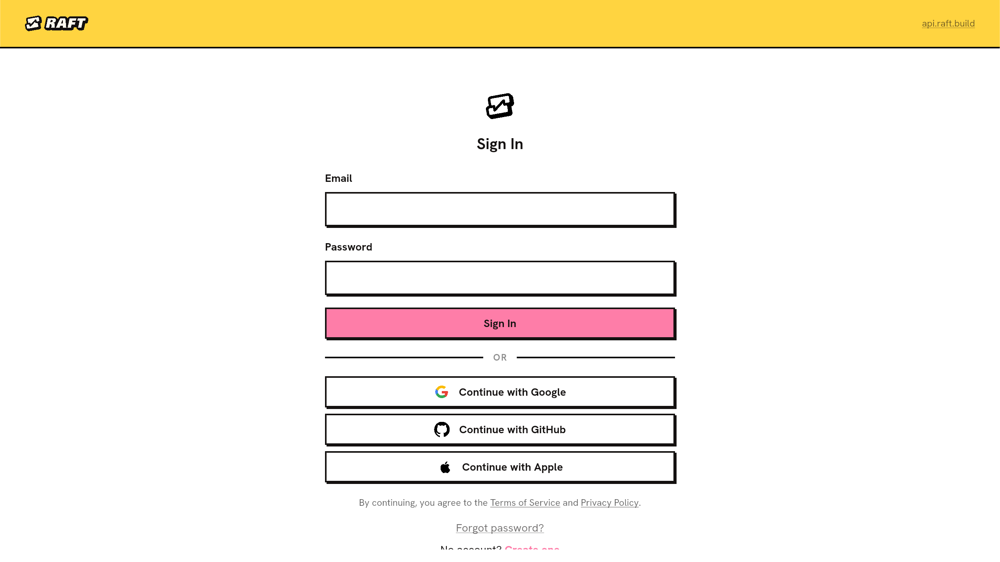

# Linux AppImage screenshot

The 2560 × 1440 PNG is an original production AppImage window capture on Ubuntu
24.04 at actual `GDK_SCALE=2`, not an enlarged image. The direct launch,
extract-and-run launch and bundled PDF conversion passed. No account or workspace
was imported. This proves native startup, not login or full feature acceptance.

[Source build and startup checks](https://github.com/kevinzhow/raft-flutter/actions/runs/38247319392).
That run's Fedora setup failed before executing the AppImage; later compatibility
results are recorded separately. [Source, scaling and digests](raft-linux-appimage-hidpi-2026-10-12.json).

The older Flatpak screenshot below is retained as historical evidence. Releases
now use AppImage; Flatpak is no longer a release target.

# Historical Flatpak screenshot

The 2560 × 1440 PNG is an original window capture at actual `GDK_SCALE=2`,
not an enlarged image. It shows the production app in a fresh Flatpak desktop
with a working Secret Service keyring. No account or workspace was imported.

[Build and native startup check](https://github.com/kevinzhow/raft-flutter/actions/runs/38237992017).
Source commit, scale and image SHA-256 are recorded in
[the screenshot metadata](raft-linux-flatpak-hidpi-2026-10-12.json).
This screenshot does not establish login, messaging or full platform acceptance.
